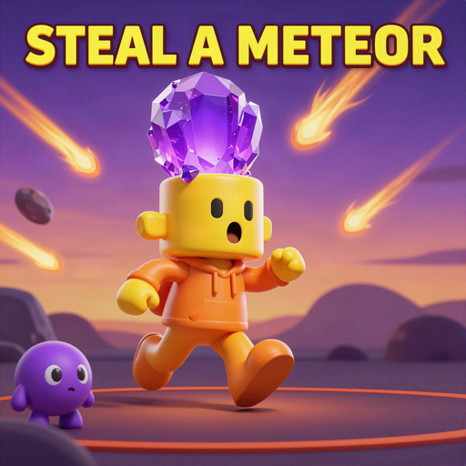

# ☄️ Steal a Meteor

Roblox-игра в жанре «укради и неси на базу» (как нынешний №1 Steal an Egg), но со своими механиками.
Весь код написан на Luau; карта, модели и интерфейс создаются скриптами, поэтому никаких импортированных ассетов не нужно.

## Почему такая идея (исследование трендов, ноябрь 2026)

Тренды я смотрел через YouTube-аналитику (Nexlev):

| Что вирусится | Сигнал |
|---|---|
| **Steal an Egg**: №1 игра Roblox | видео по ней набирают 0.3–2.1M просмотров за неделю («Black Market update», «100 days», «Started over with NO ROBUX») |
| **«+1 Speed every second»** | волна шортсов и длинных видео (+1 Speed Keyboard Escape, +1 Sword/Muscle) |
| **События, где весь сервер бьётся за одну редкую вещь** | самые смотрибельные моменты в роликах: «Phoenix spawned», «admin abuse», «secret T-Rex» |
| **Мутации, Index, редкости Divine/Secret** | «I completed the Index», «10 mutations on my biggest egg» |

Вывод из разборов разработчиков: **клон с другим словом в названии («steal a sushi») не взлетает**, нужна своя уникальная система. Поэтому мы берём работающий цикл (украл → донёс → пассивный доход), а механику подачи делаем свою.

## Чем игра отличается

- **Метеориты падают с неба в реальном времени.** Сначала появляется красный круг удара, через 3 секунды прилетает метеорит с огненным хвостом, земля трясётся. Весь сервер видит круг и бежит к нему.
- **Скорость +1 в секунду** на Speed Pad своей базы. Скорость открывает дальние зоны.
- **4 зоны с воротами по скорости**: Meadow → Crater Dunes (40) → Lava Rift (90, лужи лавы) → Cosmic Void (160, вращающиеся балки). Чем дальше зона, тем реже и дороже метеориты.
- **Переноска над головой**: тяжёлый метеорит замедляет. Другие игроки бьют тебя **молотом**, и ты роняешь добычу.
- **Кража с чужих баз**: подойди к чужому Meteorling и зажми E. Если владелец ударит вора, существо само возвращается домой. От воров спасает **лазерный замок базы** (45 сек).
- **Вылупление**: метеорит остывает на пьедестале и раскрывается в **Meteorling**, который приносит $/сек.
- **24 Meteorling, 8 редкостей** (Common → Secret), **мутации** Golden ×2 / Rainbow ×5 / Void ×10, **Index** (+2% к доходу за каждого нового).
- **Серверные события**: «Метеоритный дождь» (×3 метеоритов, мутированные метеориты) и «Золотая комета» (световой столб в небе, весь сервер бежит за ней). Оба можно **купить за Robux**, и весь сервер увидит ник покупателя.
- **Ребёрт**: ×1.5 к доходу за каждый, Meteorling сохраняются.
- Офлайн-доход, автосохранение (DataStore), адаптивный интерфейс для телефона и ПК.

## Как запустить

### Вариант 1: готовый файл (без инструментов)
1. Скачай `build/StealAMeteor.rbxlx`.
2. Открой его в **Roblox Studio** (File → Open from File).
3. Нажми **Play**. Карта строится автоматически при старте.

Для теста с несколькими игроками: вкладка **Test → Clients and Servers → 2–3 players → Start**. Так можно проверить кражу и молот.

### Вариант 2: Rojo (для разработки)
```bash
rokit install                      # ставит rojo, selene, stylua из rokit.toml
rojo serve                         # и подключи плагин Rojo в Studio
# или собрать файл места:
rojo build -o build/StealAMeteor.rbxlx
```
Без Rojo файл места собирается так: `python3 tools/build_rbxlx.py`.
Быстрая проверка синтаксиса: `python3 tools/luau_check.py src` (полноценный линтер: `selene src`).

## Перед публикацией (чек-лист)

1. **Game Settings → Places → Max Players = 6** (на карте 6 баз).
2. **Game Settings → Security → Enable Studio Access to API Services**, чтобы сохранения работали в Studio.
3. Создай Game Passes и Developer Products на Creator Dashboard и вставь их ID в `src/shared/Config.luau` (`Config.GamePasses`, `Config.Products`). Пока ID равен `0`, кнопка пишет «Coming soon!».
4. Иконка и миниатюры: продающая обложка решает. По данным разработчиков хорошая миниатюра даёт CTR 4–7% против 1–2% у средней. Сделай 10+ вариантов и прогони их через рекламу.
5. **Добавь видео на страницу игры.** В примере из разбора без видео до запуска дошли 2.5% кликнувших, с видео 50–75%.

## Иконка

`marketing/icon_512.png` (размер для Roblox) и `marketing/icon_2048.png` (исходник). Сгенерирована через Higgsfield; персонаж собственный, без чужих брендов.



## Монетизация (в Config.luau)

| Game Pass | Эффект |
|---|---|
| 2x Cash | ×2 к доходу |
| 2x Speed Pad | Speed Pad даёт ×2 скорости |
| VIP | +2 пьедестала, +25% удачи, длинный замок, золотой тег |
| Auto Collect | деньги сразу в кошелёк |
| Mega Hammer | больше радиус и чаще удары |

| Developer Product | Эффект |
|---|---|
| +50 Speed | мгновенно +50 скорости |
| Instant Hatch | вылупить всё сейчас |
| 2x Luck (15 мин) | удача мутаций ×2 |
| Summon Meteor Shower | дождь на весь сервер с твоим ником |
| Summon Golden Comet | золотая комета на весь сервер |

## Баланс

Все цифры собраны в `src/shared/Config.luau`: доход Meteorling, время вылупления, шансы мутаций, веса редкостей по зонам, пороги скорости, цены апгрейдов, частота событий.

## Структура

```
default.project.json         Rojo-проект
src/shared/                  ReplicatedStorage.Shared
  Config.luau                весь баланс
  Util.luau                  форматирование чисел, формулы цен
  Remotes.luau               RemoteEvents/Functions
src/server/                  ServerScriptService.Server
  Main.server.luau           точка входа
  Modules/MapBuilder.luau    генерация карты (базы, зоны, ворота, ловушки)
  Modules/Visuals.luau       модели метеоритов, Meteorling, молота
  Services/DataService       сохранения + синхронизация с клиентом
  Services/PlayerService     персонаж, скорость, пассы, множители
  Services/PlotService       базы, пьедесталы, доход, кража, замок
  Services/MeteorService     падение, подбор, переноска, ворота, лава
  Services/CombatService     молот
  Services/ShopService       покупки, ребёрт, ProcessReceipt
  Services/EventService      метеоритный дождь, золотая комета
src/client/                  StarterPlayerScripts.Client
  Main.client.luau
  Controllers/UI.luau        HUD, магазин, Index, ребёрт, уведомления
  Controllers/World.luau     подсказки Sell/Steal, таймеры, луч к базе
  Controllers/Effects.luau   отбрасывание, тряска камеры, звуки
tools/                       сборщик .rbxlx и проверка Luau на Python
```

## Что можно добавить дальше

- Торговля Meteorling между игроками
- Еженедельные обновления зон (рецепт роста Steal an Egg: «Alien Planet update», «Black Market update»)
- Глобальный лидерборд (OrderedDataStore)
- Собственные 3D-модели Meteorling вместо процедурных
